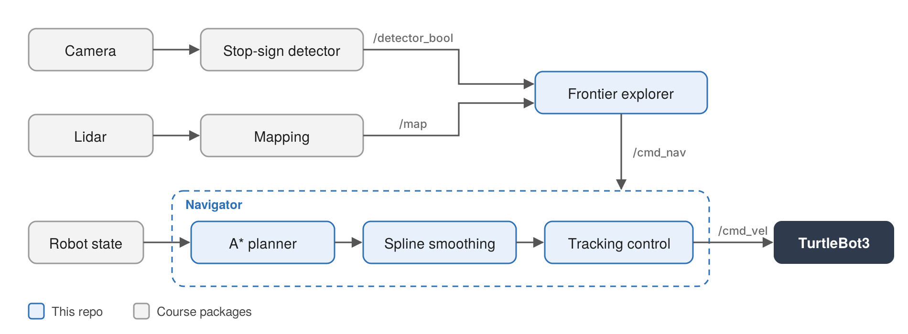
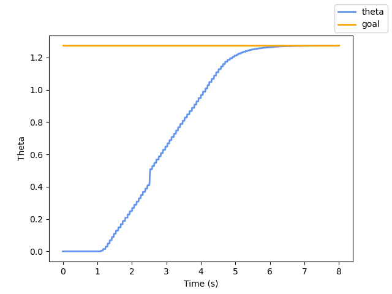

# TurtleBot Autonomy Stack (ROS 2)

A full autonomy stack for a TurtleBot3, built as a team project for Stanford CS 237A, Principles of Robot Autonomy (Fall 2026).
The robot explores an unknown environment on its own: it maps as it drives, picks where to go next, plans a collision-free
path, follows it with a tracking controller, and stops for 5 seconds when its camera detects a stop sign.

Everything was tested in the Gazebo simulator first, then run unchanged on a physical TurtleBot3.

## How it fits together

<p align="center">
  
</p>

## Components

All in `autonomy_repo/`.

| File | What it does |
|---|---|
| `scripts/heading_controller.py` | Proportional controller that turns the robot to a goal heading, with the gain exposed as a ROS 2 parameter |
| `scripts/navigator.py` | Plans and follows paths to a goal pose: A* on the occupancy grid, cubic-spline smoothing, and a trajectory-tracking controller |
| `scripts/frontier_explorer.py` | Chooses exploration goals from the live map and sends them to the navigator; handles failed goals and stop signs |
| `scripts/perception_controller.py` | Test controller that spins the robot in place and stops whenever the detector sees a stop sign |
| `launch/frontier_exploration.launch.py` | Starts RViz, the state publisher, the navigator, and (after 5 s) the frontier explorer |
| `launch/navigator.launch.py`, `heading_control.launch.py`, `perception_controller.launch.py` | Launch files for testing each piece on its own |

## How each part works

### Navigator: plan, smooth, track

1. **Plan.** A* searches the occupancy grid (8-connected, Euclidean edge costs) for the shortest collision-free path to the
   goal. The heuristic norm (L1, L2 or L∞) and its weight are configurable, so it can also run as weighted A*.
2. **Smooth.** The grid path is jagged, so each waypoint gets a time stamp from a constant-speed profile, and smoothing cubic
   splines are fit to x(t) and y(t). This gives a continuous trajectory with velocities and accelerations at every instant.
3. **Track.** A differential-flatness (feedback-linearizing) controller follows the trajectory. It combines the spline's
   desired acceleration with PD feedback on position and velocity error, then inverts the unicycle model to get the linear
   acceleration and turn rate. A small speed floor avoids the controller's singularity at zero velocity.

Before driving, the robot turns to face its path, and at the goal it turns to the goal heading, both with the heading controller.

### Frontier explorer: decide where to go

A cell is a **frontier** when the 11 × 11 window around it is at least 25% unexplored, at least 35% known free space, and has no
obstacles. Once a second, the explorer:

- sends the navigator the closest frontier, facing the direction of travel;
- drops a goal and **blacklists** it if planning fails or it takes over 60 s, so the robot never gets stuck retrying it;
- switches goals early if its current goal has already been mapped;
- declares exploration complete after three checks in a row find no frontiers.

**Stop signs.** When the detector reports a stop sign, the explorer sends the robot's current pose as the goal, so the
navigator parks right away. After 5 seconds, exploration resumes toward the closest frontier. For the next 5 seconds the
explorer ignores detections, so the same stop sign doesn't stop the robot again as it drives away.

## Results

<p align="center">
  
</p>

Heading controller step response in simulation: the robot turns to the goal heading and settles without overshoot.

The full stack ran in simulation and on the physical TurtleBot: goal-to-goal navigation, autonomous frontier exploration of
the lab environment, and stopping at stop signs during exploration.

## Running it

Requires ROS 2 Humble, Gazebo, and the course's TurtleBot support packages (`asl_tb3_lib`, `asl_tb3_msgs`, `asl_tb3_sim`,
`asl_tb3_driver`), which are not included here.

```bash
# build
cd ~/autonomy_ws && colcon build && source install/setup.bash

# simulation
ros2 launch asl_tb3_sim root.launch.py                      # terminal 1
ros2 launch autonomy_repo frontier_exploration.launch.py    # terminal 2

# hardware (after bringing up the robot over SSH)
ros2 launch autonomy_repo frontier_exploration.launch.py use_sim_time:=false
```

To test the stop-sign behavior in simulation without a camera, publish a fake detection:

```bash
ros2 topic pub --once /detector_bool std_msgs/msg/Bool "{data: true}"
```

## Repo layout

| Path | Contents |
|---|---|
| `autonomy_repo/` | The autonomy stack described above |
| `s2_basic/`, `s3_basic/` | Early lab exercises: a first ROS 2 node, launch files and RViz setup |
| `scripts/` | Week-one setup scripts |
